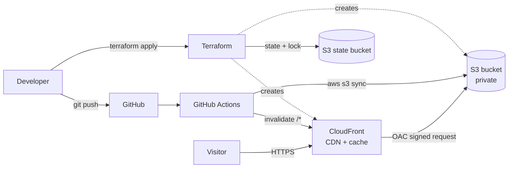

# Portfolio on AWS: S3 + CloudFront, Terraform, GitHub Actions

My React portfolio, hosted on AWS. All the infrastructure is written as code with **Terraform**, and **GitHub Actions** checks and deploys every change automatically.

**Live site:** https://d1s1nxewzrqqa9.cloudfront.net

This is Project 1 of my DevOps learning roadmap: learn by building.

---

## Architecture



- **Visitors** only reach **CloudFront**. The S3 bucket is private, and nobody can read it directly.
- **CloudFront** reads the bucket with **Origin Access Control (OAC)**. The bucket policy allows only this one distribution.
- **Terraform** builds everything. Its state is stored remotely in S3, with locking.
- **GitHub Actions** builds the React app and uploads it to S3 on every push to `main`.

## Tech stack

| Area | Tools |
|---|---|
| App | React (Create React App), React Router |
| Cloud | AWS S3, CloudFront, IAM (region `ap-southeast-2`) |
| Infrastructure as Code | Terraform 1.16, AWS provider 6.x, S3 backend with native locking |
| CI/CD | GitHub Actions |

## How it works

### 1. Pull request checks (`.github/workflows/checks.yml`)

Runs on every pull request to `main`. Two jobs run in parallel and need **no AWS credentials**:

- **Build website:** `npm ci` and `npm run build`
- **Check Terraform:** `terraform fmt -check`, `terraform init -backend=false`, `terraform validate`

### 2. Deploy (`.github/workflows/deploy.yml`)

Runs on every push to `main` (it skips changes that only touch `infra/` or `.md` files):

1. Install packages with `npm ci` and build the app (`GENERATE_SOURCEMAP=false`)
2. Log in to AWS with a least-privilege IAM user (keys stored in GitHub Secrets)
3. Upload the build with `aws s3 sync build/ s3://<bucket> --delete`
4. Clear the CloudFront cache with an invalidation of `/*`

A full deploy takes about 2 minutes.

## Repository structure

```
.
├── .github/workflows/
│   ├── checks.yml      # CI: runs on pull requests
│   └── deploy.yml      # CD: runs on push to main
├── infra/              # Terraform
│   ├── versions.tf     # Terraform and provider versions
│   ├── backend.tf      # Remote state in S3 with locking
│   ├── variables.tf    # Inputs (AWS region)
│   ├── providers.tf    # AWS provider and default tags
│   ├── main.tf         # Reads the AWS account ID
│   ├── s3.tf           # Private website bucket
│   ├── cloudfront.tf   # OAC, distribution, bucket policy, outputs
│   └── ci-user.tf      # Least-privilege IAM user for GitHub Actions
├── public/
├── src/                # React app
└── package.json
```

## Design decisions

| Decision | Why |
|---|---|
| **S3 + CloudFront, not a server (EC2)** | The site is static. There is no server to patch, it is cheap, and it is fast worldwide. |
| **Private bucket + OAC** | Visitors can only use CloudFront (HTTPS and caching). S3 website hosting would need a public bucket and has no HTTPS. |
| **403/404 → `/index.html` with status 200** | React Router uses real URLs like `/about`. Those files do not exist in S3, so CloudFront returns `index.html` and React shows the right page. |
| **Remote state in S3 with `use_lockfile`** | The state is safe if my laptop breaks, and two applies cannot run at the same time. S3-native locking means no DynamoDB table is needed. |
| **State bucket created with the AWS CLI** | Terraform cannot store its state in a bucket that it has not created yet (chicken and egg). Versioning is on, so old states can be restored. |
| **`default_tags` on the provider** | Every resource is tagged with Project, ManagedBy and Owner, so I can find resources and track costs. |
| **IAM user + access keys instead of OIDC** | See the trade-off below. |

### Trade-off: why not OIDC?

The best practice for GitHub Actions is **OIDC**: GitHub gets short-lived AWS credentials for each run, and no keys are stored.

I tried it, but my AWS account type blocks it. `iam:ListOpenIDConnectProviders` returned `AccessDenied` because of an **explicit deny in a service control policy (SCP)**.

So I used the safest option that was allowed:

- A dedicated IAM user, `github-actions-deployer`, created with Terraform
- A **least-privilege** policy: it can only list, read, upload and delete files in this one bucket, and create invalidations on this one distribution
- The access key was created with the AWS CLI, **not Terraform**, so the secret is never saved in the state file
- The keys are stored in **GitHub Secrets** and rotated when needed

In a normal AWS account, I would switch to OIDC with an IAM role and delete this user.

## Problems I solved

| Problem | Fix | Lesson |
|---|---|---|
| The network dropped during `terraform apply`. It left `errored.tfstate` and a stuck state lock. | Confirmed it was my own lock, ran `terraform force-unlock`, checked AWS for half-created resources, then ran `apply` again. | Check the real state in AWS before you fix anything. Never unlock someone else's lock. |
| A secret access key was exposed by mistake. | Rotated it: created a new key, updated the GitHub Secrets, deleted the old key. | A leaked secret must be replaced at once. |
| GitHub rejected the push of the workflow file. | My Git login was missing the `workflow` scope. I logged in again with the GitHub CLI: `gh auth login -s workflow`. | Workflow files need extra permission to push. |
| OIDC was blocked by an SCP. | Used a least-privilege IAM user (see above). | Know the limits of your account, and choose the safest allowed option. |

## Run it yourself

**The app, locally:**

```bash
npm ci
npm start      # http://localhost:3000
```

**The infrastructure:**

```bash
aws login --profile <your-profile>   # or any other AWS login
cd infra
terraform init
terraform plan
terraform apply
```

Before the first `init`, create the state bucket and update `infra/backend.tf` with its name. After `apply`, run `terraform output` to see the website URL and the distribution ID.

## What I would add next

- A custom domain with Route 53 and an ACM certificate
- OIDC instead of access keys (in an account that allows it)
- Branch protection on `main`, so code can only arrive through a pull request with green checks
- `terraform plan` as a comment on pull requests
- Long cache headers for files in `static/` and no-cache for `index.html`
